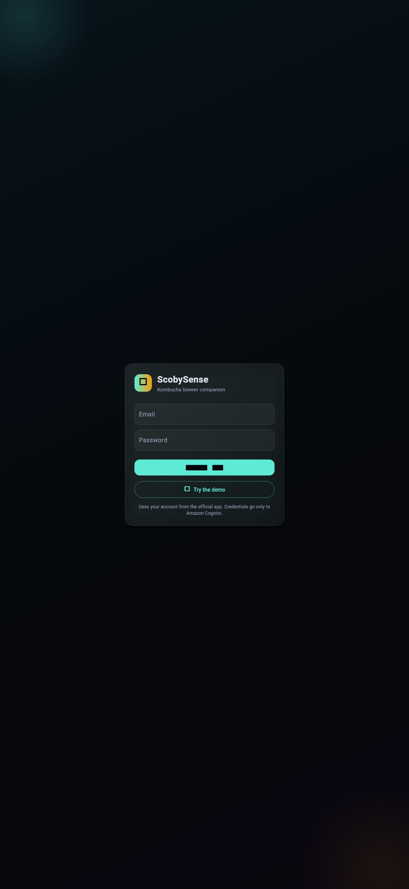
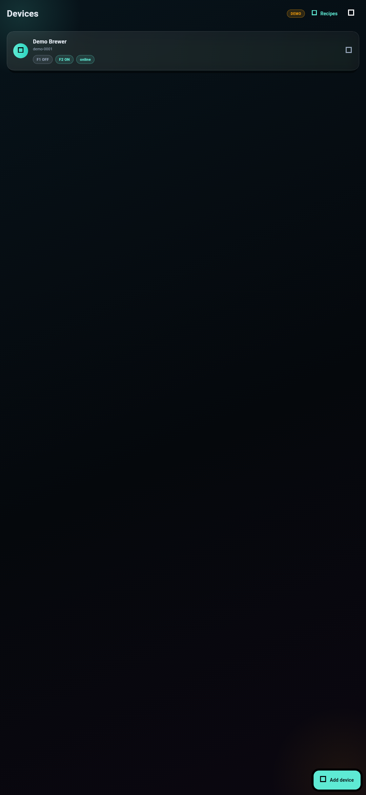
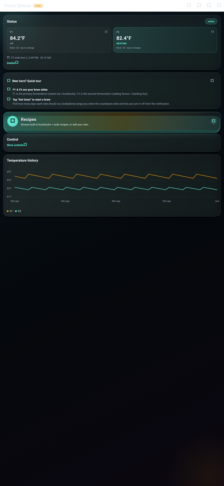
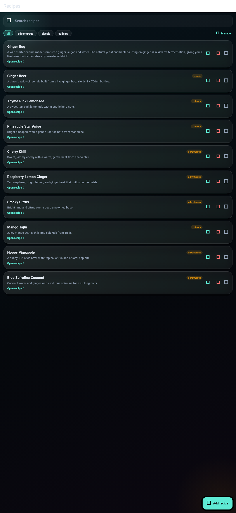

# ScobySense

A clean, community-built Android companion for the **Fermenstation** kombucha brewer — live brew monitoring, full device control, and an in-app recipe library.

<p align="center">
  
  
  
  
</p>

> **Unofficial fan project.** ScobySense is not made by, endorsed by, or affiliated with the device manufacturer. It talks to the same cloud backend the official app uses, with your own account. It can break if that backend changes.

## Screenshots

| Sign in | Devices | Live brew | Recipes |
|---------|---------|-----------|---------|
|  |  |  |  |

## Features

**Monitoring**
- Real-time F1 / F2 temperatures and remaining brew time
- Brew-cycle history and batch tracking
- Live updates pushed over the device's realtime channel

**Control**
- Set a brew timer in **days, hours, or minutes**
- Turn a fermenter off from the app
- Toggle the sound

**Recipes**
- Built-in kombucha and soda recipes (metric + US units)
- Add, edit, and remove your own
- Manage category tabs — add and rename them

**Quality of life**
- Save login (secure storage, auto-refresh)
- 12-hour / 24-hour time toggle
- Passive "update available" banner
- Local device rename, WiFi status, pull-to-refresh
- Local alert notifications
- First-launch legal disclaimer

## Install

1. Grab the latest APK from **[Releases](https://github.com/Predator04/ScobySense/releases)**.
2. Open it and allow "install unknown apps" when prompted.
3. Sign in with the account you use in the official app.

You need a Fermenstation device already paired in the official app before ScobySense can see it.

## Privacy

ScobySense runs entirely on your device and has no backend of its own. See **[PRIVACY.md](PRIVACY.md)** for exactly what goes where.

## Build from source

```bash
flutter pub get
flutter build apk --release
```

Release signing needs a `keystore.properties` file (not committed) next to `android/`:

```
storeFile=../scobysense-release.keystore
storePassword=...
keyPassword=...
keyAlias=scobysense
```

## FAQ

**Is this the official app?** No. It's an independent third-party client.

**Do I need a Fermenstation?** Yes — it reads and controls your own device through your account.

**Is it free?** Yes. Personal, non-commercial use is free. See the [license](LICENSE).

## Legal

ScobySense is an independent, third-party client. "Fermenstation" is a trademark of its respective owner and is used here only to identify the compatible hardware. This project provides no warranty; use at your own risk, and comply with the device manufacturer's own terms.

If you are the rights holder and would like this project removed, open an issue at <https://github.com/Predator04/ScobySense/issues> and it will be taken down.
